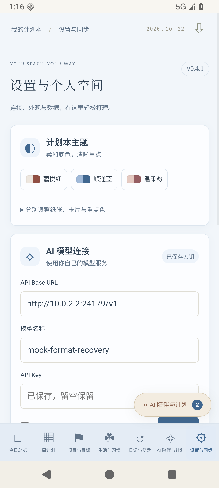

# Nong Planner

一款开源的中文生活计划本与 AI 生活管理助手，把日程、项目、习惯、日记和陪伴聊天放在一起。

**感谢 B 站 UP 主 ElenaLin_青青的计划本创作与启发。** 本项目是独立开发的软件实现，与 UP 主无隶属或官方合作关系。原计划本 PDF、版面与作者素材未随项目分发；MIT 许可证适用于本项目代码，不授予第三方计划本素材的使用权。

[下载 Android 最新版](https://github.com/lexie825828/NONG_planner/releases/latest) · [历史版本](https://github.com/lexie825828/NONG_planner/releases) · [更新记录](CHANGELOG.md) · [Android 使用与构建](android/README.md) · [测试说明](docs/TESTING.md)

## 20261023 更新 · v0.6.0

- 项目任务主列表展示中长期，短期行动折叠在对应项目或明确的中长期目标下；可直接拆解课时，周计划中的执行安排保留。
- 今日总览每日计划前置，卡片短按约 240ms 后拖动排序；也可上下移动、恢复默认。布局参与备份与设备同步。
- 每日金句按北京时间日期从本地句库轮换；点击日期打开月历，可查看日程和 DDL、切月与跳到某一天。
- 新增鹅黄、清新绿主题，支持纸张、卡片、重点色混搭及 Android 原生保存。
- 同步纳入前几版的习惯临期展示、周计划缩放/当天定位、未完成待安排池、进度备注、聊天连续滚动与本地主动复盘提醒。
- 修正进度条显示比例；通过 35 项核心测试、电脑/手机/平板尺寸浏览器回归和 Android 16 / API 36 虚拟手机专项。正式包覆盖升级后全部记录逐项比较一致。

[下载 v0.6.0 安装包](https://github.com/lexie825828/NONG_planner/releases/tag/v0.6.0) · [测试与边界](docs/TESTING.md)

## 可以做什么

- **日程与周计划**：每日安排、独立周待办、完成打卡；浏览一周时保持滚动位置。
- **项目与目标**：年度 / 季度愿景、大项目拆解、任务截止日期与进度。
- **循环习惯**：按天、周、月循环，根据最新打卡重算，例如每两个月更换床单。
- **日记与复盘**：心情与能量记录、手写日记、周 / 月 / 年度复盘。
- **AI 陪伴与计划**：自定义 Bot 姓名、多会话、图片、上下文压缩、生活教练建议；基于记录提出问题和计划草稿。模型建议需要用户检查确认，才会写入计划本。
- **日历与同步**：Android 授权后自动维护专属本地系统日历；电脑、手机和 iPad 可连接同一个个人服务同步，也可导出备份和只读日历。
- **五套主题**：囍悦红、顺遂蓝、温柔粉、鹅黄、清新绿，一键切换或分别调整纸张、卡片与重点色。



## 支持的平台

| 平台 | 使用方式 |
| --- | --- |
| Android 8.0+ | 独立 APK，本地保存，可直接连接模型；需要现代 Android System WebView |
| Windows | Node.js 本机服务 + Edge / Chrome，可作为 PWA 安装 |
| iPad | 浏览器 / PWA，连接运行中的个人服务；跨设备安装建议 HTTPS |

目前没有独立 Windows EXE 或原生 iPad 安装包。Android 默认独立运行，不需要一直开着电脑。

## Android 安装

1. 从 [Releases](https://github.com/lexie825828/NONG_planner/releases/latest) 下载正式版 `Nong-Planner-0.6.0.apk`。
2. 在手机文件管理器中打开，按系统提示允许安装。
3. 从旧版升级请直接覆盖安装，不要先卸载。升级前可在设置中导出备份。
4. 需要日历或循环通知时，在设置中开启并授权；在系统日历中勾选“Nong Planner”日历。

正式 APK 使用项目发布证书签名；签名私钥不公开。自行构建的 APK 使用自己的证书，无法直接覆盖官方签名版本。

## 在电脑启动

需要 Node.js 22 或更新版本，核心应用无第三方 npm 运行依赖。

```sh
git clone https://github.com/lexie825828/NONG_planner.git
cd NONG_planner
npm start
```

打开 [http://127.0.0.1:4173](http://127.0.0.1:4173)。Windows 也可以双击 `start.cmd`。

需要局域网同步时运行 `start-lan.cmd`，在手机中填写电脑实际局域网地址和电脑设置中的配对密钥。不要将电脑地址填为手机自己的 `localhost`。公网部署请自行配置 HTTPS；具体流程见 [Android 说明](android/README.md)。

## 配置 AI

在“设置与同步”填写服务商的 **API Base URL、模型 ID 和 API Key**。使用兼容 Chat Completions 的接口，程序自动追加 `/chat/completions`。图片识别需要模型支持图片输入。

项目不提供模型账户、密钥或赠送额度。每个聊天窗口自动发送稳定的 `x-opencode-session` 和真实客户端标识；是否支持当前用途、可用模型和额度以服务商规则为准。

模型返回计划卡片后，先检查内容，再确认写入。若只返回文字，可点击回复下的“生成计划卡片”；明确提到保存草稿但没有卡片时，应用最多自动追加一次格式补全请求，可能产生额外模型费用。

## 数据如何保存

- 电脑服务端：本地 `data/` 目录；浏览器离线记录使用 IndexedDB。
- Android：应用私有目录与 WebView 本地存储；API Key 通过 Android Keystore 加密保存。
- 聊天时，近期计划、已确认记忆、本会话摘要和消息（含所选图片）会发送给你配置的模型服务。删除会话与删除已经确认保存的计划是不同操作。
- 备份不含模型密钥。配对密钥具有个人空间读写权限，日历订阅链接具有只读访问权限，请自行保管。
- 循环通知受 Android 省电策略影响，后台检查可能延迟。日历联动目前是计划本写入专属本地日历，不会将手机日历的编辑自动写回，也不会自动上传 OPPO / Google 云日历。

## 开发与测试

```sh
npm test
```

35 项核心回归测试覆盖计划确认、同步冲突、AI 格式恢复、会话隔离、日期与日历逻辑。浏览器 UI 测试需自行安装 Playwright 和浏览器，详见 [测试说明](docs/TESTING.md)。

Android 构建脚本为 `android/build.ps1`，需要 Windows、PowerShell 7、JDK 17+、Android Build Tools 35 与 SDK Platform 35。详见 [构建说明](android/README.md)。

## 历史版本说明

仓库导入了现存的 0.3.0、0.3.1、0.3.2、0.4.0、0.4.1 安装包及版本标签。**早期版本没有保留完整原始 Git 记录**：0.3.x / 0.4.0 标签下的 `public/` 从相应 APK 恢复，只包含当时的 Web 前端；没有伪造当时的完整原生与服务端源码。`main` 和 `v0.6.0` 提供当前完整可构建源码；`v0.4.1` 保留上次公开的完整源码。

0.3.0、0.3.1 存在已知 Android 启动问题，作为历史预发布归档，不建议日常安装。请优先使用最新稳定版。

## 开源与反馈

代码使用 [MIT License](LICENSE)。欢迎通过 [Issues](https://github.com/lexie825828/NONG_planner/issues) 报告问题或提出建议，提交时请说明版本、设备和复现步骤，并移除密钥及私人聊天内容。
